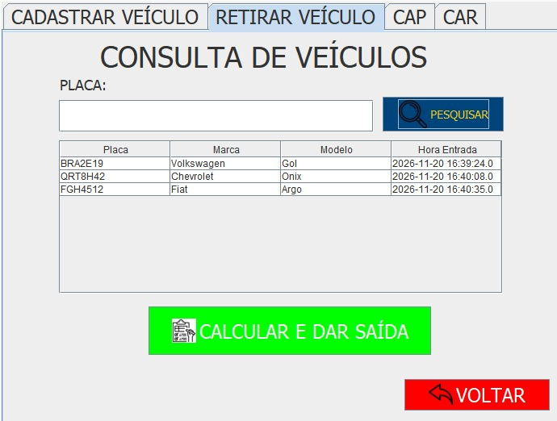
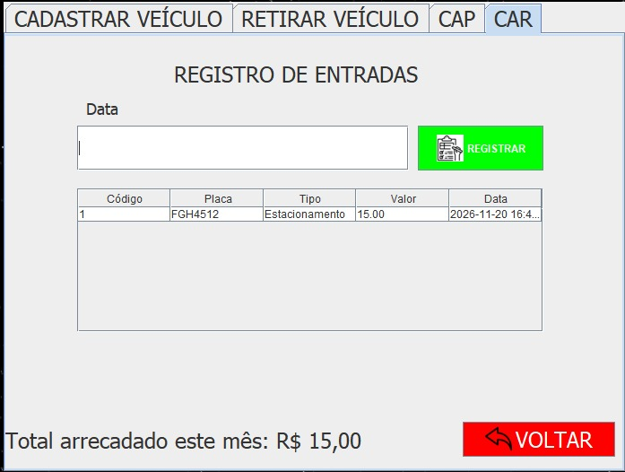
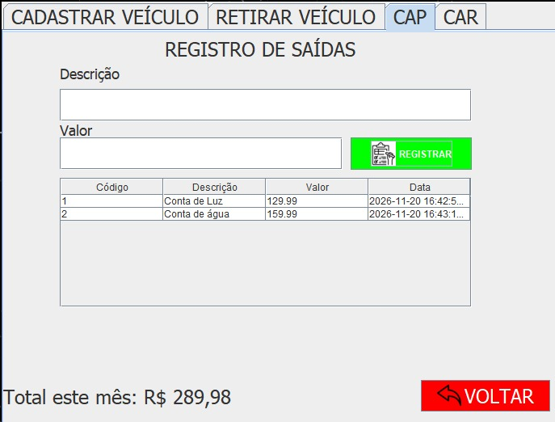

# Sistema de Estacionamento

Sistema desktop em Java para controle de entrada e saída de veículos e gestão financeira de estacionamento. Ele calcula o tempo de permanência e o valor da tarifa automaticamente e, a cada saída confirmada, registra o lançamento em Contas a Receber no módulo financeiro.

## Telas

### Tela de login

### Cadastro de veículos

### Controle de pátio e saída

### Contas a Receber (CAR)

### Contas a Pagar (CAP)

## Funcionalidades

**Autenticação e controle de acesso**
- Login com dois perfis de usuário: **Gerente** (acesso completo ao pátio e aos módulos financeiros) e **Funcionário** (acesso operacional ao controle de veículos)
- Validação de credenciais antes de liberar o menu principal

**Cadastro de veículos**
- Registro de entrada com placa, marca e modelo
- Conversão automática da placa para maiúsculas e registro da data/hora de entrada pelo banco (`NOW()`) com status `ATIVO`

**Controle de pátio e saída**
- Pesquisa de veículos ativos pela placa
- Cálculo automático do tempo de permanência: tolerância gratuita para permanência inferior a 10 minutos e cobrança de R$ 15,00 por hora após esse período (mínimo de 1 hora)
- Janela de confirmação exibindo resumo do tempo e valor total antes de finalizar a saída, alterando o status do veículo para `INATIVO`

**Financeiro (Contas a Receber e Contas a Pagar)**
- Cada saída confirmada gera automaticamente um registro em Contas a Receber (`CAR`)
- Cadastro e listagem de despesas operacionais em Contas a Pagar (`CAP`)
- Cálculo automático dos totais arrecadados e a pagar

## Tecnologias

- Java
- Swing (interface gráfica, feita no NetBeans)
- JDBC
- MySQL (rodando via XAMPP)

## Como rodar

### 1. Pré-requisitos
- JDK
- NetBeans
- XAMPP, com o **MySQL** iniciado

### 2. Criar o banco de dados
O arquivo [`banco.sql`](banco.sql) cria o banco `ESTACIONAMENTO` e as tabelas `VEICULO`, `CAR` e `CAP`. Escolha uma das opções:

**Pelo phpMyAdmin**
1. Com o MySQL ligado, abra `http://localhost/phpmyadmin`
2. Clique na aba **SQL**
3. Cole o conteúdo do `banco.sql` e clique em **Executar**

**Pelo terminal (Shell do XAMPP)**

    mysql -u root < caminho\do\banco.sql

### 3. Conferir a conexão
A conexão com o banco está configurada nas classes DAO (`VeiculoDAO`, `Car_DAO`, `Cap_DAO`) e na tela `MenuIncial_GUI`. O padrão utilizado é `127.0.0.1` na porta `3306`, usuário `root` e senha vazia. Se a sua instalação do MySQL usar outra porta ou senha, ajuste a string `url` nesses arquivos.

### 4. Executar
Abra o projeto no NetBeans, certifique-se de que o driver `mysql-connector-java` está adicionado nas bibliotecas e execute o projeto (`Main` ou `TelaLogin_GUI`).

Credenciais padrão para acesso:
- **Gerente:** usuário `Gerente` | senha `admin`
- **Funcionário:** usuário `Funcionario` | senha `abc1234`

## Arquitetura

O projeto segue o padrão MVC com DAO:

    src/
    ├── Controller   # carregamento do driver JDBC (IniciarBD_DTO)
    ├── Images       # ícones e logotipos da interface
    ├── Model        # acesso ao banco e regras de negócio (VeiculoDAO, Car_DAO, Cap_DAO, VerificarLogin_DAO)
    ├── View         # telas Swing (TelaSplash_GUI, TelaLogin_GUI, MenuIncial_GUI)
    └── main         # classe inicial da aplicação (Main)

Fluxo principal: ao confirmar a saída de um veículo, o `VeiculoDAO` atualiza o registro na tabela `VEICULO` com o horário de saída e o valor cobrado, e insere automaticamente a receita correspondente na tabela `CAR`.

## Próximos passos

- Centralizar a configuração de conexão em uma única classe dedicada
- Adicionar edição e exclusão de registros em Contas a Pagar e Contas a Receber
- Implementar filtro por período nos relatórios financeiros

## Autor

Davi Alexander Cunha Barbosa
[GitHub](https://github.com/Davialexander0310) | [LinkedIn](https://linkedin.com/in/davi-alexander-cunha-barbosa)
